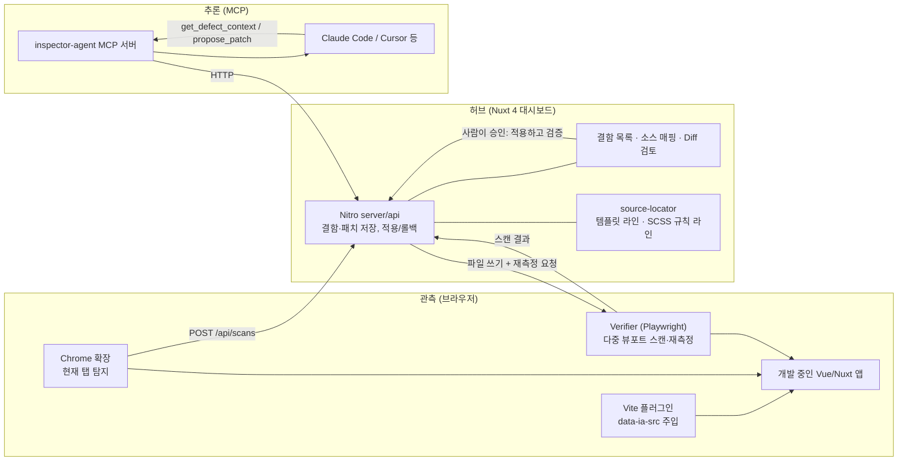

# Inspector-Agent

> 실제 브라우저 렌더링에서 깨진 레이아웃을 **규칙으로 찾아내고**, 그 DOM 노드를 **`.vue` 파일의 정확한 라인과 SCSS 규칙**에 연결한 뒤, 에이전트가 만든 패치를 **같은 뷰포트에서 다시 측정해 수치로 증명**하는 런타임 특화 자가 치유(Self-Healing) 개발 도구입니다.

```
375px 뷰포트 · src/components/ProductCard.vue:4
부모 콘텐츠 311px, 요소 박스 473px → 230px 가로 오버플로우
패치 적용 후 재측정: 230px → 0px, 새 결함 없음 ✓
```

---

## 1. 왜 만들었나

Claude Code 같은 AI 코딩 어시스턴트는 강력하지만 **텍스트(소스 코드)만 봅니다.** 아래 결함은 소스에 "버그"로 적혀 있지 않고, 브라우저가 렌더 트리를 계산한 뒤에야 드러납니다.

- 뷰포트를 375px로 줄였을 때 Flex 아이템이나 긴 텍스트가 부모 밖으로 밀려나는 **가로 오버플로우**
- `z-index` / stacking context 충돌로 모달·드롭다운이 가려지는 현상
- 모달 포커스 트랩 누락 같은 **접근성 위반**
- CSS 상속과 레이아웃 계산이 겹쳐서 생기는 런타임 렌더링 결함

### "브라우저 MCP를 붙이면 되지 않나?"

Chrome DevTools MCP나 Playwright MCP를 붙이면 에이전트도 DOM과 스크린샷을 볼 수 있습니다. 하지만 그것은 **눈**만 주는 것입니다. 에이전트는 여전히 다음을 스스로 추측해야 합니다.

| 질문 | 범용 브라우저 MCP | Inspector-Agent |
| --- | --- | --- |
| 어디가 깨졌나? | LLM이 스크린샷/DOM을 보고 추측 | **결정론적 규칙**이 수치로 탐지 (LLM 호출 0회) |
| 그 노드는 어느 파일 몇 번째 줄인가? | 클래스명으로 grep 추측 | **Vite 플러그인이 주입한 `파일:라인:컬럼`** + 해당 클래스를 스타일링하는 **SCSS 규칙 라인** |
| 무엇을 넘겨야 하나? | 페이지 전체 DOM/스타일 | 결함 노드와 직계 부모의 **레이아웃 스타일 차이와 수치만** |
| 고쳐졌나? | "고쳤습니다"라는 LLM의 주장 | 같은 뷰포트에서 **재측정 → 0px이 아니거나 새 결함이 생기면 자동 롤백** |

> 범용 브라우저 MCP는 눈만 줍니다. Inspector-Agent는 결함을 찾는 규칙, 소스 라인 매핑, 수치 검증까지 제공해 에이전트가 추측 없이 고치게 합니다.

---

## 2. 차별점

1. **결정론적 탐지 엔진** (`packages/core`): `getBoundingClientRect`, `scrollWidth/clientWidth`, `ComputedStyle`만으로 오버플로우를 판정합니다. 조상의 `overflow: auto/hidden`으로 의도된 스크롤은 제외하고, 같은 오버플로우가 조상으로 전파된 중복은 가장 깊은 원인 노드 하나로 줄입니다. 원인 분류(`flex-item-min-width`, `nowrap-text`, `fixed-width` 등)도 규칙으로 합니다.
2. **런타임 노드 → 소스 라인 매핑** (`packages/vite-plugin`, `packages/source-locator`): 개발 서버에서 `.vue` 템플릿의 모든 HTML 요소에 `data-ia-src="src/components/Card.vue:12:5"`를 주입합니다. 그다음 SCSS 중첩(`&__title`, 하위 선택자, `@media`)을 펼쳐 노드·부모·자식 클래스를 **실제로 스타일링하는 규칙의 라인**을 찾습니다.
3. **측정 기반 검증 루프** (`packages/verifier`): 패치 적용 → HMR 대기 → 헤드리스 Chromium으로 같은 URL·뷰포트 재스캔 → 대상 결함이 사라졌고 **새 결함(회귀)이 없을 때만 통과**합니다. 실패하면 백업으로 자동 롤백합니다.
4. **토큰 효율·성공률 벤치마크** (`benchmarks`): 정답표가 있는 데모 앱으로 탐지 정확도, 매핑 정확도, 토큰 절감률, 자가 치유 성공률을 재현 가능하게 측정합니다.

---

## 3. 아키텍처



### 4단계 파이프라인

1. **관측**: Chrome 확장(현재 탭) 또는 Verifier(헤드리스, 375/768/1280px)가 같은 탐지기 번들(`detector.global.js`)을 페이지에 주입해 결함을 찾습니다.
2. **컨텍스트 압축**: 결함 노드와 직계 부모의 레이아웃 속성 중 **기본값이 아닌 것만** 남기고, 부모와 같은 상속 속성은 자식에서 제거합니다. 여기에 템플릿 해당 라인 ±6줄과 SCSS 규칙을 한 줄 요약으로 붙입니다.
3. **패치 생성**: 에이전트가 MCP `get_defect_context`로 컨텍스트를 받고 `propose_patch`로 "정확히 한 번 등장하는 원문 → 새 내용" 편집을 제안합니다. 파일은 아직 바뀌지 않습니다.
4. **시각적 검토 및 반영**: 대시보드에서 사람이 Diff를 보고 **적용하고 검증**을 누르면 백업 → 반영 → 재측정 → 통과/자동 롤백까지 한 번에 진행됩니다. 통과한 패치도 언제든 롤백할 수 있습니다.

### 패키지 구성 (pnpm 모노레포)

| 경로 | 역할 |
| --- | --- |
| `packages/core` | 공용 타입, 결정론적 탐지기(브라우저용 IIFE 번들 포함), 원인 진단, 페이로드 압축, 검색/치환 편집 적용 |
| `packages/vite-plugin` | `.vue` 템플릿 요소에 `data-ia-src` 주입 (`enforce: 'pre'`, 개발 서버 전용, 컴포넌트 태그 제외) |
| `packages/source-locator` | 템플릿 스니펫, SCSS 중첩 해석과 규칙 라인 탐색, 규칙 기반 패치 생성 |
| `packages/verifier` | Playwright 다중 뷰포트 스캔, 패치 전후 재측정과 회귀 판정, `inspector-scan` CLI |
| `packages/mcp-server` | stdio MCP 서버: `scan_page`, `list_defects`, `get_defect_context`, `propose_patch`, `get_patch_status` (+ 자율 모드 `apply_patch`) |
| `packages/extension` | Chrome 확장 (MV3). 현재 탭의 실제 뷰포트에서 탐지해 대시보드로 전송 |
| `apps/dashboard` | Nuxt 4 대시보드. 결함 현황, 소스 매핑, 에이전트 컨텍스트, Diff 검토, 적용/롤백 |
| `apps/playground` | 정답 결함 8건(오버플로우 4, 가려짐 3, 포커스 이탈 1)과 정상 대조군 6건을 심어 둔 Vue 3 데모 앱 (벤치마크 대상) |
| `apps/playground-nuxt` | Nuxt 4(`app/`, layouts, 자동 import 컴포넌트)에서 `data-ia-src` 매핑이 맞는지 확인하는 최소 앱 |
| `benchmarks` | 탐지·매핑·토큰·자가 치유 벤치마크 |

---

## 4. 빠른 시작

```bash
pnpm install               # 설치 후 prepare 단계에서 packages/* 를 자동 빌드 (MCP 서버 dist 포함)

# Chromium 이 없다면 한 번 설치 (또는 INSPECTOR_CHROMIUM_PATH 로 경로 지정)
pnpm dlx playwright@1.56.1 install chromium

pnpm dev:playground        # http://localhost:5173  결함이 심어진 데모 앱
pnpm dev:dashboard         # http://localhost:3000  대시보드 (기본 패치 대상: apps/playground)
```

대시보드에서 **스캔 실행**을 누르면 375px에서 결함 8건(오버플로우 4, 가려짐 3, 포커스 이탈 1)이 나타나고 768/1280px 에서는 0건입니다. 결함을 열어 소스 매핑을 확인하고, 규칙 기반 제안이나 에이전트 패치를 **적용하고 검증**해 보세요. 내 프로젝트에 붙여 매일 쓰는 방법은 [5. 운영 가이드](#5-운영-가이드)에 있습니다.

### Claude Code 연결

저장소 루트의 `.mcp.json`이 MCP 서버(`packages/mcp-server/dist/index.js`)를 등록합니다. `/mcp`에서 `CONNECTION_CLOSED`가 보이면 빌드 결과물이 없는 경우이니 `pnpm build` 후 Claude Code를 다시 시작하세요. Claude Code를 이 저장소에서 실행하고 이렇게 요청하면 됩니다.

```
inspector-agent 로 http://localhost:5173 을 스캔하고, 미해결 결함마다 컨텍스트를 읽어 패치를 제안해줘.
```

에이전트가 제안한 패치는 대시보드에서 사람이 승인합니다. 사람 없이 에이전트가 적용·검증까지 반복하게 하려면 `INSPECTOR_ALLOW_AGENT_APPLY=1`을 설정하세요. 이때 `apply_patch` 도구가 추가됩니다.

### 내 프로젝트에 붙이기

```ts
// vite.config.ts
import vue from '@vitejs/plugin-vue'
import inspectorAgent from '@inspector-agent/vite-plugin'

export default defineConfig({
  plugins: [inspectorAgent(), vue()] // vue 플러그인보다 앞에 둔다
})
```

```bash
INSPECTOR_PROJECT_ROOT=/path/to/my-app pnpm dev:dashboard
```

| 환경 변수 | 기본값 | 설명 |
| --- | --- | --- |
| `INSPECTOR_PROJECT_ROOT` | `../playground` | 패치를 반영할 프로젝트 루트. 이 밖의 경로와 `node_modules`는 수정을 거부합니다 |
| `INSPECTOR_DATA_DIR` | `.inspector-agent` | 결함/패치 저장소(`store.json`)와 백업 위치 |
| `INSPECTOR_SETTLE_MS` | `800` | 파일 반영 후 재측정 전 HMR 대기 시간 |
| `INSPECTOR_CHROMIUM_PATH` | Playwright 기본 | 헤드리스 Chromium 실행 파일 |
| `INSPECTOR_DASHBOARD_URL` | `http://localhost:3000` | MCP 서버가 호출할 대시보드 주소 |
| `INSPECTOR_ALLOW_AGENT_APPLY` | 미설정 | `1`이면 MCP에 `apply_patch` 노출 (자율 모드) |
| `INSPECTOR_ALLOWED_HOSTS` | 미설정 | 대시보드는 `localhost`/`127.0.0.1`/`[::1]` 로 들어온 요청만 받습니다. 다른 호스트 이름으로 열 때 쉼표로 추가 |

Chrome 확장은 `packages/extension/dist`를 `chrome://extensions` → **압축해제된 확장 프로그램 로드**로 불러옵니다.

---

## 5. 운영 가이드

"테스트로 돌려 보는 법"이 아니라 **내 프로젝트에 붙여 두고 매일 쓰는 법**입니다. 처음 한 번 하는 준비(5.2), 개발 중 반복하는 루프(5.3), 결함 종류별 대응(5.4), 에이전트에게 어디까지 맡길지(5.5), 스캔 방법 선택(5.6), CI(5.7), 데이터 관리(5.8), 오탐 대응(5.9), 문제 해결(5.10) 순서입니다.

### 5.1 누가 무엇을 하나

| 구성 요소 | 하는 일 | 언제 켜 두나 |
| --- | --- | --- |
| 내 앱의 개발 서버 | Vite 플러그인이 `.vue` 요소에 `data-ia-src="파일:라인:컬럼"` 을 주입 (개발 서버 전용) | 개발하는 동안 |
| 대시보드 (`pnpm dev:dashboard`) | 결함·패치 저장, 헤드리스 스캔, Diff 검토, 적용·재측정·롤백. **내 프로젝트 파일을 실제로 쓰는 유일한 곳** | 개발하는 동안 |
| MCP 서버 | Claude Code 가 대시보드를 호출하는 통로 (`scan_page`, `list_defects`, `get_defect_context`, `propose_patch`, `get_patch_status`) | Claude Code 세션 동안 (자동 실행) |
| `inspector-scan` CLI | 스캔만 하고 종료 코드로 판정. CI 용 | 필요할 때 / CI |
| Chrome 확장 | 지금 보고 있는 탭을 그대로 탐지해 대시보드로 전송 | 로그인·데이터가 필요한 화면을 볼 때 |

에이전트는 파일을 직접 고치지 않습니다. **제안(`propose_patch`) → 사람이 승인(또는 자율 모드) → 대시보드가 백업·반영·재측정** 순서로만 파일이 바뀌고, 재측정에 실패하면 대시보드가 원본으로 되돌립니다.

### 5.2 처음 한 번: 내 프로젝트에 붙이기

준비물은 Node 22, pnpm 10, Chromium(`pnpm dlx playwright@1.56.1 install chromium`, 또는 `INSPECTOR_CHROMIUM_PATH`)입니다.

**1) 플러그인을 내 프로젝트에 설치** — 패키지가 아직 레지스트리에 올라가 있지 않으므로 이 저장소의 빌드 결과를 링크합니다.

```bash
# Inspector-Agent 저장소에서 (한 번)
pnpm install && pnpm build

# 내 프로젝트에서
pnpm add -D link:../Inspector-Agent/packages/vite-plugin   # 경로는 실제 위치에 맞게
```

**2) 플러그인 등록** — 개발 서버에서만 동작하며 프로덕션 빌드에는 속성이 들어가지 않습니다(`includeBuild: true` 를 주지 않는 한).

```ts
// Vite + Vue: vite.config.ts  (vue 플러그인보다 앞에)
plugins: [inspectorAgent(), vue()]

// Nuxt 4: nuxt.config.ts
import inspectorAgent from '@inspector-agent/vite-plugin'
export default defineNuxtConfig({ vite: { plugins: [inspectorAgent()] } })
```

Nuxt 4 처럼 소스가 `app/` 아래에 있어도 속성의 경로는 **프로젝트 루트(`package.json` 이 있는 폴더) 기준**(`app/pages/index.vue:12:5`)으로 만들어집니다.

**3) 대시보드를 내 프로젝트에 연결** — 파일을 쓸 대상(`INSPECTOR_PROJECT_ROOT`)과 데이터 위치를 지정해 띄웁니다.

```bash
INSPECTOR_PROJECT_ROOT=/abs/path/my-app \
INSPECTOR_DATA_DIR=$PWD/.data/my-app \
pnpm dev:dashboard                      # http://localhost:3000
```

- `INSPECTOR_PROJECT_ROOT` 는 반드시 `data-ia-src` 경로의 기준과 같은 **프로젝트 루트**여야 합니다. 다르면 결함 컨텍스트에 템플릿과 SCSS 규칙이 비어서 나옵니다(5.10).
- 데이터를 내 프로젝트 안에 두면 `.gitignore` 에 추가해야 합니다. 이 저장소의 `.data/` 는 이미 git 에서 제외돼 있습니다.

**4) Claude Code 연결** — 이 저장소의 `.mcp.json` 이 MCP 서버를 등록합니다. 내 프로젝트에서 Claude Code 를 쓰려면 같은 설정을 내 프로젝트의 `.mcp.json` 에 복사하고 `command`/`args` 를 이 저장소의 절대 경로로, `INSPECTOR_DASHBOARD_URL` 을 대시보드 주소로 바꿉니다.

```json
{
  "mcpServers": {
    "inspector-agent": {
      "command": "node",
      "args": ["/abs/path/Inspector-Agent/packages/mcp-server/dist/index.js"],
      "env": { "INSPECTOR_DASHBOARD_URL": "http://localhost:3000" }
    }
  }
}
```

**5) 확인** — Claude Code 의 `/mcp` 에서 `inspector-agent` 가 연결돼 있고, 대시보드에서 스캔 후 결함 상세에 템플릿 스니펫과 SCSS 규칙이 보이면 준비 끝입니다.

### 5.3 일상 운영 루프

1. **켜기**: 내 앱 개발 서버, 대시보드(터미널 2개). Claude Code 를 쓰면 MCP 서버는 자동으로 뜹니다.
2. **스캔**: 화면을 만들거나 고친 뒤 스캔합니다(방법은 5.6). 기본 뷰포트는 375/768/1280px 이고, 같은 결함도 뷰포트·URL 마다 별개로 기록됩니다.
3. **우선순위 정하기**: 대시보드 목록은 심각도 순입니다. 먼저 `high`(24px 이상 넘침, 페이지 가로 스크롤 유발, 가려짐 80% 이상, 포커스 이탈)를 처리하고, 같은 컴포넌트에서 나온 중복(뷰포트별, URL별)은 한 번 고치면 같이 사라집니다.
4. **패치 만들기** (둘 중 하나)
   - **에이전트**: Claude Code 에 `inspector-agent 로 http://localhost:5173 을 스캔하고, high 결함부터 컨텍스트를 읽어 패치를 제안해줘` 처럼 요청합니다. 에이전트는 `get_defect_context` 로 압축 컨텍스트(수치, 템플릿 스니펫, 노드·부모·자식 SCSS 규칙, 진단)를 읽고 `propose_patch` 로 제안합니다.
   - **규칙 기반**: 대시보드 결함 상세의 **이 규칙으로 패치 제안** 버튼. 선언만으로 고칠 수 있는 진단(오버플로우, z-index 부족)에만 나타납니다.
5. **검토하고 적용**: 결함 상세의 Diff 를 읽고 **적용하고 검증**을 누릅니다. 대시보드가 백업 → 반영 → `INSPECTOR_SETTLE_MS` 만큼 HMR 대기 → 같은 URL·뷰포트로 재측정합니다. 통과(검증 통과)하면 결함이 `resolved`, 실패하면 자동 롤백되고(`open`) 사유가 한 줄로 남습니다. 필요 없는 제안은 **거절**합니다.
6. **실패했을 때**: 검증 문구(예: `오버플로우가 180px → 42px로 남아 있습니다`, `새 결함 1건이 생겼습니다`)를 에이전트에게 그대로 주고 다시 제안하게 합니다. 복합 원인(예: flex item `min-width: auto` + 자식 `nowrap`)은 한 번에 둘 다 고쳐야 통과합니다.
7. **롤백**: 통과한 패치도 나중에 **롤백**할 수 있습니다(백업에서 복구).
8. **해소 확인과 커밋**: 같은 URL·뷰포트를 다시 스캔하면 사라진 `open` 결함이 `resolved` 로 바뀝니다(스캔 결과의 "해소 N건"). `git diff` 로 최종 변경을 한 번 더 확인하고 커밋합니다.

### 5.4 결함 종류별 대응

| 종류 | 무엇이 문제인가 | 자동(규칙) 패치 | 처리 요령 | 재측정 통과 기준 |
| --- | --- | --- | --- | --- |
| `overflow-x` | 박스·텍스트가 부모 콘텐츠 영역을 넘음 | 대부분 가능 | 진단 1순위(`flex-item-min-width`, `flex-shrink-disabled`, `fixed-width`, `unbreakable-text`…)를 먼저 시도. 자식이 원인이면 노드와 자식을 함께 수정 | 넘친 px 가 0, 새 결함 없음 |
| `occluded` | 모달·드롭다운 같은 팝업이 다른 요소에 가려짐 | `z-index-too-low` 만 가능 | `stacking-context-trap` 은 z-index 를 올려도 소용없음. 갇힌 조상의 `transform`/`opacity`/`filter` 등을 없애거나 팝업을 `<Teleport to="body">` 로 옮김. `overflow-clipped-popup` 은 자르는 조상의 `overflow` 를 풀거나 팝업을 body 로 이동 | 가려진 비율이 **0%** (일부만 풀려도 실패) |
| `focus-escape` | 열린 모달에서 Tab/Shift+Tab 으로 포커스가 모달 밖으로 나감 | 불가능(JS 필요) | 모달 안 `keydown` 핸들러로 첫/마지막 요소를 순환시키거나 배경에 `inert`, 네이티브 `<dialog>.showModal()` 사용. `aria-modal` 은 포커스를 가두지 않음 | 앞·뒤 **두 방향 모두** 모달 안에 머묾 |

자동 패치가 불가능한 결함은 에이전트가 구조를 바꿔 제안해야 하고, 대시보드는 그런 제안에 대해서는 규칙 패치 버튼을 보여 주지 않습니다.

### 5.5 승인 모드와 자율 모드

| | 승인 모드 (기본) | 자율 모드 (`INSPECTOR_ALLOW_AGENT_APPLY=1`) |
| --- | --- | --- |
| 에이전트가 하는 일 | 제안까지 | 제안 → `apply_patch` 로 적용 → 재측정 결과를 보고 재제안 |
| 파일 반영 | 사람이 대시보드에서 승인 | 사람 승인 없이 대시보드가 바로 반영 |
| 켜는 방법 | 기본값 | `.mcp.json` 의 `env` 에 `"INSPECTOR_ALLOW_AGENT_APPLY": "1"` 추가 후 Claude Code 재시작 |

자율 모드는 켜기 전에 아래를 지키는 것을 권장합니다.

- **전용 브랜치에서, 작업 트리를 깨끗하게 한 뒤** 켭니다. 끝난 뒤 `git diff` 가 곧 에이전트가 한 일의 전부입니다.
- 대시보드의 **안전장치**는 이렇습니다: 모든 경로가 `INSPECTOR_PROJECT_ROOT` 안으로 제한되고 `node_modules` 는 거부, 반영 전 백업, 제안 이후 파일이 바뀌었으면 적용 거부(409), 재측정 실패 시 자동 롤백. API 는 CORS 를 열지 않고, 로컬 주소가 아닌 Host(DNS 리바인딩)와 다른 웹사이트에서 온 쓰기 요청(Origin 불일치)을 403 으로 거부합니다. MCP 서버, CLI, 대시보드 화면, Chrome 확장은 그대로 동작합니다.
- 하지만 **검증은 "대상 결함이 사라졌고, 같은 뷰포트에 새 결함이 없다"까지만** 봅니다. 다른 페이지, 다른 뷰포트, 열려야 보이는 UI 에서 생긴 회귀와 디자인 의도는 못 봅니다. 자율 모드가 끝나면 사람이 diff 를 훑고, 모든 뷰포트로 다시 스캔하세요.
- **시도 횟수 제한은 코드에 없습니다.** 에이전트에게 "결함당 최대 3회, 그래도 안 되면 멈추고 보고"처럼 지시하세요(벤치마크 실측도 이 조건이었습니다).
- 대상은 로컬 개발 서버와 로컬 프로젝트 루트입니다. 원격·프로덕션 URL 을 스캔할 수는 있어도 거기에는 `data-ia-src` 가 없어 소스 매핑이 안 됩니다.

### 5.6 스캔 방법 고르기

| 방법 | 어떻게 | 특징 | 한계 |
| --- | --- | --- | --- |
| 대시보드 폼 | 메인 화면의 **스캔 실행** (URL, 뷰포트 입력) | 가장 간단. 결과가 바로 저장됨 | URL 만 연다 (아래 참고) |
| MCP `scan_page` | 에이전트에게 "스캔해줘" | 에이전트가 스캔→패치를 한 번에 진행 | 대시보드 폼과 같음 |
| CLI | `node packages/verifier/dist/cli.js <url> [--viewports 375,768x1024] [--report http://localhost:3000] [--fail-on high] [--summary 파일]` | 종료 코드·마크다운 요약. `--report` 로 대시보드에도 저장 | 같음 |
| Chrome 확장 | `pnpm build` 후 `packages/extension/dist` 를 `chrome://extensions` → **압축해제된 확장 프로그램 로드**. 확장 팝업에 대시보드 주소 입력 | **지금 보고 있는 탭 그대로** 탐지 (로그인, 시드 데이터, 인터랙션 후 상태 포함) | `localhost`/`127.0.0.1` 만, 탭의 실제 너비 1개만, **모달 포커스 이탈 검사는 하지 않음** |

**상태에 의존하는 화면 주의**: 헤드리스 스캔은 URL 만 열기 때문에 로그인이 필요하거나 데이터가 있어야 그려지는 화면은 빈 상태로 검사되고, 이때 "결함 0건"은 **안전하다는 뜻이 아닙니다.** 실제 앱(Camping-Joy)에서 데이터 없이 스캔했을 때 13개 URL 이 전부 0건이었습니다. 이런 화면은 ① 확장으로 실제 탭을 스캔하거나 ② 시드 데이터를 쿼리·라우트로 주입할 수 있는 개발 전용 경로를 만들어 그 URL 을 스캔하세요. 또 스캔 시점에 **이미 열려 있는** 모달·드롭다운만 가려짐·포커스 검사 대상이므로, 닫혀 있는 팝업은 열린 상태로 보이는 URL(또는 확장 + 직접 열기)로 검사해야 합니다.

### 5.7 CI 운영

이 저장소에는 워크플로가 둘 있습니다.

- `.github/workflows/ci.yml` (모든 PR, `main`): 타입체크, 단위 테스트, 탐지 회귀 벤치마크(`pnpm bench`, 근사 토큰 모드). 정답표·대조군의 불변 조건(재현율·정밀도 100%, 대조군 오탐 0건, 1280px 결함 0건)이 깨지면 실패하므로 탐지 규칙을 바꾸는 PR 이 회귀를 만들면 막힙니다.
- `.github/workflows/layout-scan.yml` (수동 실행): playground 를 띄워 스캔하고, 기준 이상 결함이 있으면 실패하며 결과 표를 job summary 에 남깁니다. **이 저장소의 playground 는 벤치마크용 결함이 일부러 심겨 있어 항상 실패하는 것이 정상**이라 PR 마다 돌리지 않습니다. 내 앱에 쓸 때는 아래처럼 바꾸고 트리거에 `pull_request` 를 추가하세요.

내 앱에 쓰려면 워크플로의 "playground 실행" 단계와 `SCAN_URL` 을 내 앱의 실행 명령·주소로 바꿉니다.

```yaml
- run: pnpm start &                      # 내 앱 개발 서버 (플러그인이 켜진 개발 모드여야 소스 위치가 나옴)
- run: |
    for _ in $(seq 1 60); do curl -sf http://localhost:3000 >/dev/null && break; sleep 1; done
- run: node packages/verifier/dist/cli.js http://localhost:3000 --fail-on high --summary "$GITHUB_STEP_SUMMARY"
```

- **종료 코드**: `0` 통과 · `1` 기준 초과 · `2` 사용법 오류 또는 스캔 실패.
- **도입 순서 권장**: 처음에는 `--fail-on high` 로 시작해 기존 결함을 정리한 뒤 `medium` → `low` 로 낮춥니다. 처음부터 `low` 로 켜면 기존 결함 때문에 모든 PR 이 막힙니다.
- 요약은 실패해도 항상 남습니다. 표의 **위치**(`파일:라인`)로 바로 이동해 고치면 됩니다.
- CI 도 5.6 의 한계를 그대로 가집니다. 빈 상태 화면은 CI 에서도 빈 상태로 검사됩니다.
- PR 코멘트 게시와 기존 결함 기준선(허용 목록) 파일은 아직 없습니다.
- 위 예시는 이 저장소(`Inspector-Agent`)의 빌드 결과를 쓰므로, 내 앱의 CI 에서는 이 저장소를 함께 체크아웃해 `pnpm install && pnpm build` 한 뒤 경로를 맞춰야 합니다(패키지가 아직 레지스트리에 게시되지 않았습니다).

### 5.8 데이터와 상태 관리

- **저장 위치**: `INSPECTOR_DATA_DIR`(기본 `apps/dashboard/.inspector-agent`)의 `store.json`(결함·패치·재측정 기준선)과 `backups/<패치id>.bak`(적용 직전 원본). 사람이 열어 볼 수 있는 JSON 이고, 폴더를 지우면 초기화됩니다(대상 프로젝트 파일에는 영향 없음).
- **결함 상태**: `open`(미해결) · `patched`(자동 롤백 없이 파일에 남은 상태) · `resolved`(해결). 같은 URL·뷰포트를 재스캔했는데 사라진 `open` 결함만 `resolved` 가 되고, 해결된 결함이 다시 나타나면 `open` 으로 돌아옵니다.
- **패치 상태**: `proposed`(검토 대기) · `verified`(검증 통과) · `failed`(검증 실패, 보통 자동 롤백됨) · `rolled-back` · `rejected`.
- **여러 프로젝트를 다룰 때**: 프로젝트마다 대시보드 인스턴스를 따로 띄웁니다. 포트, `INSPECTOR_PROJECT_ROOT`, `INSPECTOR_DATA_DIR` 를 모두 다르게 주고, 그 프로젝트의 `.mcp.json` 에 해당 포트를 `INSPECTOR_DASHBOARD_URL` 로 적습니다.

  ```bash
  cd apps/dashboard
  NUXT_IGNORE_LOCK=1 INSPECTOR_PROJECT_ROOT=/abs/other-app INSPECTOR_DATA_DIR=$PWD/../../.data/other-app \
    pnpm exec nuxt dev --port 3001
  ```

  같은 `apps/dashboard` 에서 둘 이상 띄우면 Nuxt 가 실행 잠금을 걸어 두 번째가 거부되므로 `NUXT_IGNORE_LOCK=1` 이 필요하고, 두 인스턴스가 `.nuxt` 폴더를 공유한다는 점을 알아 두세요.
- **탐지기 규칙이나 패키지를 고친 뒤에는** `pnpm build` 를 하고 **대시보드(와 Claude Code)를 재시작**하세요. 오래 떠 있던 개발 서버는 옛 모듈을 메모리에 들고 있어 새 코드와 맞지 않으면 500 이 납니다(5.10).

### 5.9 오탐·미탐 대응

- **일시적으로 제외**: 검사에서 빼고 싶은 요소(또는 그 하위 전체)에 `data-ia-ignore` 속성을 붙입니다. 오버플로우, 가려짐, 모달 포커스 검사에 모두 적용됩니다. 의도한 겹침이나 스크롤이면 이유를 주석으로 남기세요.
- **오탐을 발견했다면**: 재현 컴포넌트를 `apps/playground/src/components/` 에 **정상 대조군**으로 추가하고 `benchmarks/src/fixtures.ts` 의 `NEGATIVE_CONTROLS` 에 등록한 뒤, 탐지 규칙을 고치고 `pnpm bench` 에서 대조군 오탐 0건이 유지되는지 확인합니다(불변 조건이 깨지면 `pnpm bench` 가 종료 코드 1 로 끝나므로 CI 도 같은 기준으로 실패합니다). (회전한 아이콘 오탐을 이 순서로 고쳤습니다. 실서비스 사례는 `docs/real-world-report.md`.)
- **탐지 규칙을 고칠 때의 최소 확인**: `pnpm test` → `pnpm typecheck` → `pnpm bench`. 토큰 수까지 재려면 `ANTHROPIC_API_KEY` 가 필요하고, 없으면 `INSPECTOR_BENCH_ESTIMATE=1` 로 근사 모드를 쓸 수 있습니다(결과에 `method: estimate` 표시).
- **알려진 미탐 영역**: 세로 오버플로우, 텍스트 대비 등 접근성 일반, 인터랙션 후에만 나타나는 UI, `transform` 이 걸린 요소의 박스 오버플로우. 로드맵(8)을 참고하세요.

### 5.10 문제 해결

| 증상 | 원인 | 해결 |
| --- | --- | --- |
| `/mcp` 에서 `CONNECTION_CLOSED` | MCP 서버 빌드 결과물이 없음 | `pnpm build` 후 Claude Code 재시작 |
| 결함 컨텍스트에 템플릿·SCSS 규칙이 비어 있음 (`rawFile: 0`) | `INSPECTOR_PROJECT_ROOT` 가 `data-ia-src` 경로의 기준(프로젝트 루트)과 다름, 또는 플러그인이 옛 버전 | 루트를 `package.json` 이 있는 폴더로 지정, `pnpm build` 로 플러그인 재빌드 후 앱 개발 서버 재시작 |
| 화면은 깨져 보이는데 스캔은 0건 | 빈 상태/로그인 필요/닫힌 팝업을 검사함, 또는 `data-ia-ignore` 로 제외됨 | 5.6 의 확장 스캔이나 시드 URL 사용 |
| 결함에 소스 위치가 없음 | 플러그인이 안 켜졌거나(`apply: serve` 라 프로덕션 빌드 제외), 컴포넌트 태그(`<MyCard>`)에는 속성을 주입하지 않음 | 개발 서버로 스캔. 매핑은 각 컴포넌트 안의 일반 HTML 요소 기준 |
| 대시보드 API 가 403 (`허용되지 않은 호스트`, `다른 출처의 쓰기 요청`) | `localhost` 가 아닌 호스트 이름으로 열었거나, 다른 웹사이트에서 보낸 쓰기 요청 | 다른 호스트로 열어야 하면 `INSPECTOR_ALLOWED_HOSTS` 에 추가. 대시보드 화면, MCP, CLI, 확장은 영향 없음 |
| 대시보드 500, `does not provide an export named …` | 패키지를 재빌드했는데 대시보드가 옛 모듈을 들고 있음 | 대시보드 프로세스 재시작 |
| 적용이 409 `제안 이후 파일이 바뀌었습니다` | 제안 뒤에 파일이 수정됨 | 컨텍스트를 다시 읽고 패치를 새로 제안 |
| 재측정이 들쭉날쭉하거나 항상 실패 | HMR 이 `INSPECTOR_SETTLE_MS`(기본 800ms) 안에 끝나지 않음, 개발 서버가 내려감 | `INSPECTOR_SETTLE_MS=2000` 등으로 늘리기, 앱 개발 서버 상태 확인 |
| `browserType.launch: Executable doesn't exist` | Chromium 미설치 | `pnpm dlx playwright@1.56.1 install chromium` 또는 `INSPECTOR_CHROMIUM_PATH` |
| 포트 충돌(`strictPort`, `EADDRINUSE`) | 5173/3000 이미 사용 중 | 다른 포트로 띄우고 스캔 URL, `INSPECTOR_DASHBOARD_URL` 을 맞춤 |
| 확장: `탐지기를 실행하지 못했습니다` | 탭을 확장이 열기 전에 로드했거나 `localhost`/`127.0.0.1` 이 아님 | 페이지 새로고침 후 재시도, 로컬 주소로만 사용 |
| `pnpm bench` 가 토큰 계측에서 실패 | `ANTHROPIC_API_KEY`(또는 `ant auth login`) 없음 | 키 설정 또는 `INSPECTOR_BENCH_ESTIMATE=1` |

---

## 6. 벤치마크

```bash
INSPECTOR_CHROMIUM_PATH=... pnpm bench   # 결과: benchmarks/results/latest.json
```

토큰 수는 Anthropic `count_tokens` API(기본 모델 `claude-opus-5-5`, `INSPECTOR_TOKEN_MODEL`로 변경)로 잽니다. `ANTHROPIC_API_KEY`(또는 `ant auth login`)가 필요하고, 없으면 측정을 시작하기 전에 실패합니다. API 없이 파이프라인만 확인하려면 `INSPECTOR_BENCH_ESTIMATE=1`로 4자당 1토큰 근사를 켤 수 있으며, 이때 결과 파일에 `method: estimate`가 남아 실제 토크나이저 수치와 섞이지 않습니다.

playground를 임시 디렉터리에 복사해 실행하므로 원본 파일은 바뀌지 않습니다. 아래는 2026-10-13 실행 결과입니다.

| 항목 | 결과 |
| --- | --- |
| 탐지 재현율 / 정밀도 (375px, 정답 4건) | **100% / 100%** |
| 정상 대조군(`overflow-x: auto` 표) 오탐 | **0건** |
| 1280px 결함 | 0건 (모바일에서만 깨지는 결함임을 확인) |
| 1순위 원인 진단 일치 | **4/4** |
| 노드 → `파일:라인:컬럼` 정확 매핑 | **4/4** |
| 탐지 시간 | 노드 59개, 약 4ms |
| 토큰: DOM HTML / DOM+레이아웃 스타일 / DOM+전체 ComputedStyle | 1,475 / 8,458 / 162,159 |
| 토큰: Inspector 컨텍스트 (결함 4건 합계) | **1,267** (결함당 약 317) |
| 토큰 절감률 | 레이아웃 덤프 대비 **85.0%**, 전체 스타일 덤프 대비 **99.2%** |
| 규칙 기반 자가 치유 (LLM 없음) | **3/4 치유**, 첫 시도 성공 2건, 재측정으로 잡아낸 회귀 **2건** |

자가 치유 루프 상세는 다음과 같습니다.

```
TagList.vue      +275px  flex-shrink-disabled ✗(회귀) → flex-nowrap ✓
ShareLink.vue    +253px  unbreakable-text ✓
ProductCard.vue  +230px  flex-item-min-width ✗(회귀) → flex-nowrap ✗      ← 복합 원인
PromoBanner.vue  +109px  fixed-width ✓
```

`ProductCard`는 **flex item의 `min-width: auto`와 자식 제목의 `white-space: nowrap`이 함께 원인**입니다. `min-width: 0`만 넣으면 박스 오버플로우는 사라지지만 제목 텍스트가 박스를 넘치는 새 결함이 생깁니다. 검증 루프가 이 회귀를 잡아 자동 롤백했고, 이는 "고쳤다는 주장"과 "고쳐진 것이 측정됨"의 차이를 보여 줍니다. 같은 결함에 대해 에이전트가 자식 규칙 컨텍스트를 보고 `&__info { min-width: 0 }`과 제목 말줄임을 함께 제안한 패치는 **230px → 0px, 새 결함 없음**으로 검증을 통과했습니다 (MCP `propose_patch` → 대시보드 적용으로 확인).

> **해석 시 주의**: 정답표는 이 프로젝트가 직접 심은 작은 데모 결함 4건입니다. 범용 정확도를 주장하는 수치가 아니라 파이프라인이 끝까지 동작함을 재현 가능하게 보여 주는 회귀 테스트로 봐야 합니다. 토큰 수는 4자당 1토큰 근사치입니다. 실제 서비스 페이지와 실제 토크나이저로 확장하는 것이 다음 단계입니다.


### 에이전트(LLM) 패치 성공률

규칙 기반 기준선(위 표)과 별개로, 에이전트가 MCP 컨텍스트를 읽고 직접 패치를 쓰는 경로를 `INSPECTOR_ALLOW_AGENT_APPLY=1` 자율 모드와 같은 방식(사람 승인 없이 제안 → 적용 → 재측정 → 실패 시 자동 롤백 후 재제안, 결함당 최대 3회)으로 3회 반복 실행했습니다. 대상은 playground 오버플로우 결함 4건(375px)이고, 에이전트는 `claude-sonnet-5-5` 입니다.

| 항목 | 결과 |
| --- | --- |
| LLM 패치 성공률 | **12/12 (100%)** (결함 4건 × 3회) |
| 첫 시도 성공률 | 12/12 (100%) |
| 평균 시도 횟수 | **1.00회** |
| 재제안이 일어난 결함 / 재측정으로 잡은 회귀 | 0건 / 0건 |

실행별 기록과 패치 근거는 `benchmarks/results/agent-healing.md`(요약)와 `agent-healing.json`(원시 기록, git 제외)에 있습니다.

> **해석 시 주의**: 같은 세션의 같은 에이전트가 반복한 것이라 실행 간 독립성이 없고, playground 소스에 원인을 알려 주는 주석이 있습니다. 모든 결함이 첫 시도에 통과해 **실패 후 재제안 경로는 한 번도 실행되지 않았습니다.** 이 수치는 에이전트 일반 성능의 추정치가 아니라 제안 → 적용 → 재측정 파이프라인이 에이전트 패치와 함께 끝까지 동작한다는 기록입니다. 실행은 원본을 건드리지 않도록 playground 임시 복사본에서 했습니다.

---

## 7. 기대 효과

### 개발자에게
- **반응형 QA 시간 단축**: 뷰포트를 바꿔 가며 눈으로 찾던 오버플로우를 375/768/1280px 자동 스캔으로 몇 초 안에 목록화합니다. 데모 기준 탐지는 수 ms, 패치 1건 검증은 약 2초입니다.
- **"어디를 고쳐야 하나"의 제거**: 결함이 `ProductCard.vue:4`와 `L46 .product-card__title { white-space: nowrap; }`처럼 파일·라인·규칙 단위로 바로 연결됩니다. DevTools에서 요소를 찾아 소스로 거슬러 올라가는 과정이 사라집니다.
- **안전한 적용**: 모든 반영은 백업되고, 검증에 실패하면 자동으로 원복되며, 통과한 패치도 한 번에 롤백할 수 있습니다. 제안 이후 파일이 바뀌었으면 적용을 거부해 덮어쓰기 사고를 막습니다.

### AI 에이전트 활용 측면에서
- **토큰 비용 절감**: 페이지 전체를 넘기는 대신 결함당 수백 토큰의 압축 컨텍스트만 사용합니다. 데모 기준 전체 스타일 덤프 대비 99% 이상 줄었습니다.
- **추측 대신 근거**: 에이전트는 탐지·매핑·원인 후보가 이미 정리된 상태에서 시작하므로 탐색에 쓰는 턴이 줄고, 패치가 최소 변경(기존 SCSS 규칙에 선언 추가)으로 수렴합니다.
- **신뢰할 수 있는 성공률**: 성공 여부를 재측정 수치로 기록하므로 "LLM 패치가 실제로 몇 % 고쳤는가"를 대시보드 통계로 추적할 수 있습니다. 규칙 기반 기준선과 에이전트 패치를 같은 기준으로 비교할 수 있습니다.
- **에이전트 중립성**: MCP로 노출되므로 Claude Code, Cursor 등 MCP를 지원하는 어떤 에이전트에도 붙습니다.

### 팀과 제품 품질 측면에서
- **회귀 방지**: 패치가 다른 곳을 깨뜨리면(같은 뷰포트의 새 결함) 바로 실패로 판정됩니다. 향후 CI에 스캔을 넣으면 PR 단위로 레이아웃 회귀를 막을 수 있습니다.
- **사람 중심 통제(Human-in-the-loop)**: 기본값은 사람이 Diff를 승인해야 파일이 바뀌는 구조입니다. 자율 모드는 명시적으로 켜야만 동작합니다.
- **지식의 축적**: 원인 분류 규칙(`flex-item-min-width` 등)이 코드로 남아 팀의 CSS 디버깅 노하우가 재사용 가능한 자산이 됩니다.

---

## 8. 한계와 로드맵

현재 범위는 **Vue/Nuxt의 가로 레이아웃 오버플로우, 팝업 가려짐, 모달 포커스 이탈** 세 가지입니다.

- [x] z-index / stacking context 충돌 탐지 (`elementFromPoint` 표본점 가림 검사). 스캔 시점에 열려 있는 UI 만 검사합니다
- [x] 접근성: 모달 포커스 트랩 (verifier 가 실제 Tab 키로 검사). 대비, 라벨 누락 규칙은 아직 없습니다
- [ ] 닫혀 있는 팝업·로그인 상태 화면을 스캔하기 위한 상호작용/시드 스크립트 옵션
- [ ] React(`__source`/소스맵) 매핑, CSS Modules·Tailwind 클래스 → 소스 매핑
- [ ] 실제 서비스 페이지 벤치마크와 실제 토크나이저 기반 토큰 측정, LLM 패치 성공률 리포트
- [x] CI용 `inspector-scan --fail-on` 과 job summary
- [ ] PR 코멘트 게시, 기존 결함 기준선(허용 목록) 파일
- [ ] 확장에서 뷰포트 에뮬레이션(chrome.debugger) 지원. 현재 확장은 탭의 실제 너비로만 검사합니다.
- 컴포넌트 태그(`<ItemCard>`)에는 속성을 주입하지 않습니다. fallthrough 속성이 자식 컴포넌트 루트의 위치를 덮어쓰기 때문입니다. 따라서 매핑은 각 컴포넌트 안의 일반 요소 기준입니다.

---

## 9. 개발 규칙

- 기술 스택: Nuxt 4 (Vue 3 Composition API), pnpm, SCSS(scoped), TypeScript
- SFC 블록 순서: `<template>` → `<script setup lang="ts">` → `<style lang="scss" scoped>`
- `<script setup>` 선언 순서: import → define → composable → interface/type → 변수 → lifecycle → computed → method → useHead → watch
- 모든 함수는 반환 타입을 명시한 화살표 함수로 작성하고, `null` 대신 `undefined`나 타입별 기본값을 씁니다.
- 시맨틱 마크업(`section`/`article`/`header`/`main`/`aside`), `<form @submit.prevent>`, `label[for]`과 `input[id]`의 1:1 매핑, 표에는 `caption`/`thead`/`tbody`/`th[scope]`를 씁니다.
- 주석, 문서, 커밋 메시지는 한국어로 작성합니다.

```bash
pnpm test        # core / source-locator / vite-plugin 단위 테스트
pnpm typecheck   # 전 패키지 타입 검사 (대시보드는 nuxt typecheck)
pnpm bench       # 엔드 투 엔드 벤치마크 (Chromium 필요)
```
