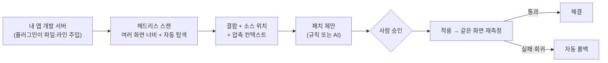

# Inspector-Agent

브라우저에서 **깨진 레이아웃을 규칙으로 찾아내고**, 그 노드를 **소스 파일의 정확한 라인**에 연결하고, 고친 뒤에는 **같은 화면에서 다시 측정해 수치로 증명**하는 도구입니다. 툴팁·팝오버·모달처럼 눌러야 열리는 UI도 스스로 열어 검사합니다.


*실제 명령(`inspector-scan`, `inspector-agent fix`)의 출력을 재생한 데모입니다. 재측정을 통과한 패치(109px → 0px)는 남기고, 새 결함을 만든 패치는 원본으로 자동 롤백하며, 규칙으로 못 고치는 결함은 건너뜁니다. Claude Code에서는 `/ia scan` 한 줄로 같은 흐름을 AI와 함께 진행합니다. 재녹화: `pnpm --filter @inspector-agent/benchmarks demo`.*

```
375px · src/components/ProductCard.vue:4
부모 콘텐츠 311px, 요소 박스 473px → 230px 가로 오버플로우
패치 적용 후 재측정: 230px → 0px, 새 결함 없음 ✓
```

## 왜 만들었나

Claude Code 같은 AI 코딩 도구는 **소스 텍스트만** 봅니다. 그런데 아래 결함은 소스에 "버그"로 적혀 있지 않고, 브라우저가 화면을 계산한 뒤에야 드러납니다.

- 화면을 375px로 줄이면 긴 텍스트나 flex 아이템이 부모 밖으로 밀려나는 **가로 오버플로우**
- `z-index`·stacking context 충돌로 **모달·드롭다운이 가려지는** 현상
- 클릭해야 열리는 **툴팁·팝오버가 화면 밖으로 나가는** 현상, 모달 **포커스 트랩 누락**

범용 브라우저 MCP를 붙이면 AI가 DOM과 스크린샷을 볼 수는 있지만, 어디가 깨졌는지·어느 파일 몇 번째 줄인지·고쳐졌는지는 여전히 **추측**해야 합니다.

| 질문 | 범용 브라우저 MCP | Inspector-Agent |
| --- | --- | --- |
| 어디가 깨졌나? | LLM이 스크린샷·DOM을 보고 추측 | **규칙이 수치로 탐지** (LLM 호출 0회) |
| 어느 파일 몇 번째 줄인가? | 클래스명으로 grep 추측 | 개발 서버가 DOM에 심은 **`파일:라인:컬럼`** + 그 클래스를 스타일링하는 **CSS 규칙 라인** |
| 고쳐졌나? | "고쳤습니다"라는 LLM의 주장 | 같은 화면에서 **재측정**, 0px이 아니거나 새 결함이 생기면 **자동 롤백** |

## 어떻게 동작하나



1. **관측**: 헤드리스 Chromium이 여러 화면 너비에서 페이지를 열고, 눌러 볼 만한 트리거를 스스로 눌러 **열린 상태**까지 규칙으로 검사합니다. (`getBoundingClientRect`, `scrollWidth`, `ComputedStyle` 같은 실제 렌더링 수치만 씁니다.)
2. **소스 연결**: Vite 플러그인이 개발 서버에서 요소마다 `data-ia-src="파일:라인:컬럼"`을 심어, 결함 노드를 소스 위치와 CSS 규칙 라인에 연결합니다.
3. **패치 제안**: 결함 노드와 부모의 **기본값이 아닌 레이아웃 스타일만** 압축해 AI(MCP) 또는 규칙 기반 진단에 넘깁니다. AI는 여기서만 쓰이고, 이 단계에서는 파일이 바뀌지 않습니다.
4. **검증**: 사람이 승인하면 백업 → 반영 → 같은 화면 재측정을 하고, 대상 결함이 사라졌고 **새 결함이 없을 때만 통과**합니다. 아니면 원본으로 자동 롤백합니다.

더 자세한 설계(탐지 규칙, 패키지 구성, 벤치마크)는 [개요](docs/overview.md)에 있습니다.

---

## 어떻게 쓸까요? 먼저 고르세요

|  | **A. 터미널** | **B. Claude Code (MCP)** |
| --- | --- | --- |
| 이런 때 | 결함 목록을 빨리 보고 싶다 · PR마다 CI로 막고 싶다 · AI 없이 자동 수정 | AI가 스캔부터 패치 제안까지 해 주길 원한다 |
| 설치 | npm 패키지 1~2개 | MCP 서버 설정 3줄 (npm) |
| 실행 | `npx inspector-scan <주소>` · `npx @inspector-agent/engine fix <주소>` | `/ia scan` |
| 고치는 방법 | 결과의 `파일:라인`을 직접 수정, 또는 `fix`로 규칙 기반 자동 수정 | AI가 제안 → 승인 창에서 diff 확인 → 적용 |
| 안전장치 | `fix`: Diff 확인 → y/N → 재측정 → 실패하면 자동 롤백 | 같음 (사람 승인 없이는 적용 안 됨) |
| 준비 시간 | 약 1분 | 약 3분 |

**→ [A. 터미널로 쓰기](#a-터미널로-쓰기)** · **→ [B. Claude Code로 쓰기](#b-claude-code로-쓰기)**

둘은 같은 탐지 엔진을 씁니다. A로 시작해 나중에 B를 더해도 됩니다.

---

## 공통 준비 (한 번만)

1. **Node 22 이상**: `node -v`
2. **스캔용 Chromium**: `npx playwright@1.56.1 install chromium`
3. **(권장) 소스 위치 표시**: 내 앱 개발 서버에 플러그인을 붙이면 결함이 `파일:라인`으로 나옵니다. 없어도 스캔은 되지만 위치 대신 CSS 선택자가 나옵니다.

```bash
npm install -D @inspector-agent/vite-plugin
```

```ts
// vite.config.ts (Vue)      plugins: [inspectorAgent(), vue()]    ← vue 보다 앞에
// vite.config.ts (React)    plugins: [inspectorAgent(), react()]  ← react 보다 앞에
import inspectorAgent from '@inspector-agent/vite-plugin'
```

```ts
// nuxt.config.ts (Nuxt 4)
import inspectorAgent from '@inspector-agent/vite-plugin'
export default defineNuxtConfig({ vite: { plugins: [inspectorAgent()] } })
```

개발 서버에서만 동작하고 프로덕션 빌드에는 들어가지 않습니다.

---

## A. 터미널로 쓰기

```bash
npm install -D @inspector-agent/verifier     # 1. 설치
npm run dev                                  # 2. 내 앱 개발 서버 실행 (예: http://localhost:5173)
npx inspector-scan http://localhost:5173     # 3. 스캔
```

결과 예:

```
[375px] 결함 1건, 문서 가로 스크롤 0px
  - [high] src/components/ShareLink.vue:4 content +253px (unbreakable-text)

[414px · 자동 탐색: click "100% 로컬 연산 (데이터 외부 전송 0 byte)"] 결함 1건, 문서 가로 스크롤 0px
  - [high] app/components/layout/SecurityBadge.vue:28 viewport +38px (keep-in-viewport)
```

결과의 `파일:라인`을 열어 고친 뒤 같은 명령을 다시 실행하면 결함이 사라진 것을 확인할 수 있습니다.

| 옵션 | 설명 |
| --- | --- |
| `--viewports 375,768x1024` | 검사할 화면 너비(또는 `너비x높이`). 기본은 320·375·414·768·1024·1280 |
| `--fail-on high` | 해당 심각도 이상이 하나라도 있으면 종료 코드 1 (CI용) |
| `--summary 파일` | 마크다운 요약을 파일에 덧붙임 (GitHub Actions: `"$GITHUB_STEP_SUMMARY"`) |
| `--no-explore` | 자동 탐색 끄기 |
| `--scenario 파일.json` | 로그인·데이터가 필요한 화면용 시나리오 ([작성법](docs/scenarios/README.md)) |

종료 코드: `0` 통과 · `1` 기준 초과 · `2` 사용법 오류 또는 스캔 실패.

### 자동으로 고치기 (`fix`)

스캔 → 규칙 기반 패치 제안 → **Diff 확인** → 승인 → 적용 → **같은 화면 재측정** → 실패하면 **자동 롤백**까지 한 번에 합니다.

```bash
npx -y @inspector-agent/engine fix http://localhost:5173
```

(예시)

```
src/components/ShareLink.vue:4 (375px, overflow-x)
-  .share-link { white-space: nowrap; }
+  .share-link { white-space: nowrap; overflow-wrap: anywhere; }
적용하고 재측정할까요? [y]예 / [N]건너뛰기 / [a]이후 모두 / [q]중단 y
  통과: 오버플로우 253px → 0px, 새 결함 없음
```

프로젝트 루트는 **현재 폴더**이고, 롤백용 백업과 결함 기록은 `.inspector-agent/`에 저장됩니다(이 폴더는 스스로 git에서 제외됩니다). `--yes`는 묻지 않고 적용하며(재측정 실패는 그대로 자동 롤백), 대화형 터미널이 아니면 `--yes` 없이는 제안만 저장합니다. 규칙으로 고칠 수 있는 결함(오버플로우, 말줄임, z-index 등)만 대상이고, 구조 변경이 필요한 결함은 B의 AI 제안을 쓰세요.

### CI에 넣기 (GitHub Actions)

```yaml
- run: npm ci && npx playwright@1.56.1 install --with-deps chromium
- run: npm run dev &                      # 내 앱 개발 서버
- run: npx wait-on http://localhost:5173 && npx inspector-scan http://localhost:5173 --fail-on high --summary "$GITHUB_STEP_SUMMARY"
```

처음에는 `--fail-on high`로 시작해 기존 결함을 정리한 뒤 `medium`, `low` 순으로 낮추세요. 처음부터 `low`로 켜면 기존 결함 때문에 모든 PR이 막힙니다.

---

## B. Claude Code로 쓰기

### 1. MCP 서버 등록

내 프로젝트 루트의 `.mcp.json`에 넣으면 끝입니다. 설정할 것이 더 없습니다.

```json
{
  "mcpServers": {
    "inspector-agent": { "command": "npx", "args": ["-y", "@inspector-agent/mcp-server"] }
  }
}
```

프로젝트 루트는 Claude Code를 연 폴더이고, 결함 기록과 롤백용 백업은 `.inspector-agent/`에 저장됩니다(이 폴더는 스스로 git에서 제외됩니다).

### 2. 슬래시 명령 (둘 중 편한 쪽)

**설치 없이:** 1번만 하면 Claude Code에 `/mcp__inspector-agent__scan`과 `/mcp__inspector-agent__status`가 자동으로 나타납니다. 이름이 깁니다.

**짧은 이름(`/ia`, `/insp`)으로 쓰려면** 한 번만 실행하세요.

```bash
npx -y @inspector-agent/mcp-server install-commands
```

모든 프로젝트에서 쓰이도록 `~/.claude/commands`에 설치합니다. 이 프로젝트에서만 쓰려면 `--project`, 같은 이름의 내 파일을 덮어쓰려면 `--force`를 붙입니다. 설치 후에는 Claude Code를 새 세션으로 여세요.

### 3. 사용

내 프로젝트에서 개발 서버를 켜고 Claude Code를 열어 입력합니다.

| 입력 | 동작 |
| --- | --- |
| `/ia scan` (또는 `/mcp__inspector-agent__scan`) | 실행 중인 개발 서버를 찾아 스캔하고, 미해결 결함마다 패치를 **제안** |
| `/ia scan http://localhost:3001` | 주소를 직접 지정 |
| `/ia status` (또는 `/mcp__inspector-agent__status`) | 스캔 없이 현재 결함과 패치 상태만 표시 |
| `/insp scan` | `/ia scan`과 같음 |

제안된 패치는 **항상 사람이 승인해야 적용됩니다.** AI가 `apply_patch`를 호출하면, **승인 창을 지원하는 클라이언트**는 diff를 보여 주고 승인을 받습니다. 승인하면 파일을 바꾼 뒤 같은 화면에서 재측정합니다. 재측정에 실패하거나 새 결함이 생기면 자동으로 원본으로 되돌립니다. 통과한 패치도 나중에 롤백할 수 있습니다.

승인 창을 지원하지 않는 클라이언트(Claude Code 버전에 따라 다를 수 있습니다)에서는 적용하지 않고, 터미널 승인을 안내합니다. 그래도 사람 승인 없이는 파일이 바뀌지 않습니다.

```bash
npx -y @inspector-agent/engine apply p_abc123     # diff 확인 → y/N → 적용·재측정(실패하면 자동 롤백)
```

적용한 패치를 되돌리려면 `npx -y @inspector-agent/engine rollback p_abc123`을 쓰세요. AI가 묻지 않고 적용·검증을 반복하게 하려면(자율 모드) MCP `env`에 `"INSPECTOR_ALLOW_AGENT_APPLY": "1"`을 넣으세요. 전용 브랜치에서만 권장합니다. 자세한 내용은 [운영 가이드](docs/operations.md#승인-모드와-자율-모드)에 있습니다.

---

## 무엇을 검사하나

**자동 탐색(기본 켜짐).** 스캔이 눌러 볼 만한 것(툴팁, 팝오버, 드롭다운, 모달 트리거, 탭, 아코디언, CSS `:hover` 메뉴)을 스스로 찾아 hover/click하고, **열린 상태**까지 6개 화면 너비에서 검사합니다. 열었을 때만 생기는 결함은 "자동 탐색: click …" 상태로 따로 기록되고, 패치 후 재측정도 같은 열린 상태에서 합니다. 삭제·결제·제출·로그아웃처럼 보이는 버튼은 누르지 않고, 탐색 중 `GET`이 아닌 요청은 막습니다.

| 종류 | 잡는 것 |
| --- | --- |
| 가로 오버플로우 | 박스·텍스트가 부모 밖으로 밀려남 |
| 화면 이탈 | 열린 툴팁·팝오버가 화면 좌우 밖으로 나감 |
| 세로 오버플로우 | 높이가 고정된 컨테이너 밖으로 내용이 넘쳐 아래 요소와 겹침 |
| 텍스트 잘림 | 말줄임 없이 글자가 잘려 사라짐 |
| 가려짐 | 모달·드롭다운이 다른 요소에 가려짐 (원인: z-index, stacking context 등) |
| 포커스 이탈 | 열린 모달에서 Tab으로 포커스가 모달 밖으로 나감 |

결함별 처리 요령은 [운영 가이드](docs/operations.md#결함-종류별-대응)에 있습니다.

**한계.** 로그인이 필요하거나 데이터가 있어야 그려지는 화면은 빈 상태로 검사되어 "결함 0건"이 안전하다는 뜻이 아닙니다. 이런 화면은 [시나리오](docs/scenarios/README.md)로 스캔하세요. `div onclick` 같은 시맨틱 정보 없는 트리거, 여러 단계를 거쳐야 열리는 UI는 자동 탐색이 못 찾을 수 있습니다.

---

## 설정 (환경 변수)

대부분 설정할 필요가 없습니다.

| 이름 | 기본값 | 설명 |
| --- | --- | --- |
| `INSPECTOR_PROJECT_ROOT` | 현재 폴더 | 패치를 반영할 프로젝트 루트. 이 밖의 경로는 수정하지 않습니다 |
| `INSPECTOR_DATA_DIR` | `<루트>/.inspector-agent` | 결함 기록과 롤백용 백업 위치 |
| `INSPECTOR_SETTLE_MS` | `800` | 파일 반영 후 재측정 전 HMR 대기(ms) |
| `INSPECTOR_CHROMIUM_PATH` | Playwright 기본 | Chromium 실행 파일 경로 |
| `INSPECTOR_ALLOW_AGENT_APPLY` | 미설정 | `1`이면 AI가 승인 없이 적용(자율 모드) |

---

## 문제 해결

| 증상 | 해결 |
| --- | --- |
| `Executable doesn't exist` | Chromium 설치: `npx playwright@1.56.1 install chromium` |
| `/mcp`에서 연결 실패(`CONNECTION_CLOSED`) | Claude Code를 재시작. 계속되면 `npx clear-npx-cache` 후 재시작 |
| 적용이 `승인 창을 띄울 수 없어` 로 거절됨 | 터미널에서 `npx -y @inspector-agent/engine apply <패치 id>` 로 승인하세요 |
| `/ia`가 보이지 않음 | `npx -y @inspector-agent/mcp-server install-commands`를 실행하고 새 세션을 여세요. 설치 없이는 `/mcp__inspector-agent__scan`을 쓰면 됩니다 |
| 새 기능이 안 나옴 | `npx clear-npx-cache` 후 Claude Code 재시작 |
| 결함에 `파일:라인` 대신 선택자만 나옴 | 공통 준비 3번의 플러그인이 켜진 **개발 서버**를 스캔하세요 (프로덕션 빌드에는 없음) |
| 화면은 깨졌는데 결함 0건 | 빈 상태·로그인 필요 화면입니다. [시나리오](docs/scenarios/README.md)를 쓰세요 |
| 재측정이 들쭉날쭉함 | `INSPECTOR_SETTLE_MS=2000`처럼 늘리고 개발 서버 상태를 확인 |
| 포트 충돌 | 다른 포트로 개발 서버를 띄우고 스캔 주소를 맞추세요 |

더 많은 증상은 [운영 가이드의 문제 해결](docs/operations.md#문제-해결)에 있습니다.

---

## 더 알아보기

| 문서 | 내용 |
| --- | --- |
| [운영 가이드](docs/operations.md) | 일상 루프, 결함별 대응, 자율 모드, CI, 데이터 관리, 오탐 대응 |
| [시나리오](docs/scenarios/README.md) | 로그인·데이터가 필요한 화면, 직접 클릭 단계 지정 |
| [개요](docs/overview.md) | 왜 만들었나, 차별점, 아키텍처, 벤치마크, 로드맵, 개발 규칙 |
| [릴리스](docs/releasing.md) | npm 배포 절차와 겪은 문제 |
| [React 소스 매핑](docs/react-source-mapping.md) | React에서 소스 위치를 찾는 방식과 선택 이유 |

패키지: [`@inspector-agent/verifier`](https://www.npmjs.com/package/@inspector-agent/verifier) · [`engine`](https://www.npmjs.com/package/@inspector-agent/engine) · [`mcp-server`](https://www.npmjs.com/package/@inspector-agent/mcp-server) · [`vite-plugin`](https://www.npmjs.com/package/@inspector-agent/vite-plugin) · [`core`](https://www.npmjs.com/package/@inspector-agent/core)
