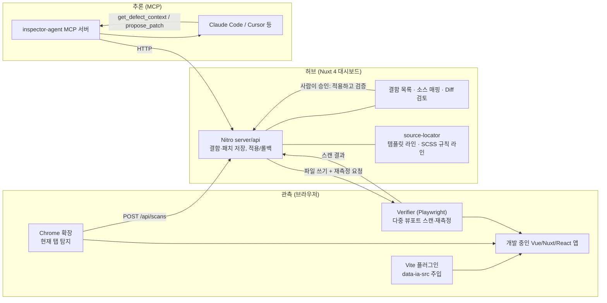

# Inspector-Agent 개요

왜 만들었는지, 어떻게 동작하는지, 얼마나 잘 동작하는지(벤치마크)를 모았습니다. 사용법은 [README](../README.md)를 보세요.

## 왜 만들었나

Claude Code 같은 AI 코딩 어시스턴트는 강력하지만 **텍스트(소스 코드)만 봅니다.** 아래 결함은 소스에 "버그"로 적혀 있지 않고, 브라우저가 렌더 트리를 계산한 뒤에야 드러납니다.

- 뷰포트를 375px로 줄였을 때 Flex 아이템이나 긴 텍스트가 부모 밖으로 밀려나는 **가로 오버플로우**
- `z-index` / stacking context 충돌로 모달·드롭다운이 가려지는 현상
- 모달 포커스 트랩 누락 같은 **접근성 위반**
- CSS 상속과 레이아웃 계산이 겹쳐서 생기는 런타임 렌더링 결함

### "브라우저 MCP를 붙이면 되지 않나?"

Chrome DevTools MCP나 Playwright MCP를 붙이면 에이전트도 DOM과 스크린샷을 볼 수 있습니다. 하지만 그것은 **눈**만 주는 것입니다. 에이전트는 여전히 다음을 스스로 추측해야 합니다.

| 질문 | 범용 브라우저 MCP | Inspector-Agent |
| --- | --- | --- |
| 어디가 깨졌나? | LLM이 스크린샷/DOM을 보고 추측 | **결정론적 규칙**이 수치로 탐지 (LLM 호출 0회) |
| 그 노드는 어느 파일 몇 번째 줄인가? | 클래스명으로 grep 추측 | **Vite 플러그인이 주입한 `파일:라인:컬럼`** + 해당 클래스를 스타일링하는 **SCSS 규칙 라인** |
| 무엇을 넘겨야 하나? | 페이지 전체 DOM/스타일 | 결함 노드와 직계 부모의 **레이아웃 스타일 차이와 수치만** |
| 고쳐졌나? | "고쳤습니다"라는 LLM의 주장 | 같은 뷰포트에서 **재측정 → 0px이 아니거나 새 결함이 생기면 자동 롤백** |

> 범용 브라우저 MCP는 눈만 줍니다. Inspector-Agent는 결함을 찾는 규칙, 소스 라인 매핑, 수치 검증까지 제공해 에이전트가 추측 없이 고치게 합니다.

---

## 차별점

1. **결정론적 탐지 엔진** (`packages/core`): `getBoundingClientRect`, `scrollWidth/clientWidth`, `ComputedStyle`만으로 오버플로우를 판정합니다. 조상의 `overflow: auto/hidden`으로 의도된 스크롤은 제외하고, 같은 오버플로우가 조상으로 전파된 중복은 가장 깊은 원인 노드 하나로 줄입니다. 원인 분류(`flex-item-min-width`, `nowrap-text`, `fixed-width` 등)도 규칙으로 합니다.
2. **런타임 노드 → 소스 라인 매핑** (`packages/vite-plugin`, `packages/source-locator`): 개발 서버에서 `.vue` 템플릿의 모든 HTML 요소에 `data-ia-src="src/components/Card.vue:12:5"`를 주입합니다. 그다음 SCSS 중첩(`&__title`, 하위 선택자, `@media`)을 펼쳐 노드·부모·자식 클래스를 **실제로 스타일링하는 규칙의 라인**을 찾습니다.
3. **측정 기반 검증 루프** (`packages/verifier`): 패치 적용 → HMR 대기 → 헤드리스 Chromium으로 같은 URL·뷰포트 재스캔 → 대상 결함이 사라졌고 **새 결함(회귀)이 없을 때만 통과**합니다. 실패하면 백업으로 자동 롤백합니다.
4. **토큰 효율·성공률 벤치마크** (`benchmarks`): 정답표가 있는 데모 앱으로 탐지 정확도, 매핑 정확도, 토큰 절감률, 자가 치유 성공률을 재현 가능하게 측정합니다.

## 아키텍처



### 4단계 파이프라인

1. **관측**: Chrome 확장(현재 탭) 또는 Verifier(헤드리스, 320~1280px 6개 뷰포트와 자동 탐색)가 같은 탐지기 번들(`detector.global.js`)을 페이지에 주입해 결함을 찾습니다.
2. **컨텍스트 압축**: 결함 노드와 직계 부모의 레이아웃 속성 중 **기본값이 아닌 것만** 남기고, 부모와 같은 상속 속성은 자식에서 제거합니다. 여기에 템플릿 해당 라인 ±6줄과 SCSS 규칙을 한 줄 요약으로 붙입니다.
3. **패치 생성**: 에이전트가 MCP `get_defect_context`로 컨텍스트를 받고 `propose_patch`로 "정확히 한 번 등장하는 원문 → 새 내용" 편집을 제안합니다. 파일은 아직 바뀌지 않습니다.
4. **시각적 검토 및 반영**: 대시보드에서 사람이 Diff를 보고 **적용하고 검증**을 누르면 백업 → 반영 → 재측정 → 통과/자동 롤백까지 한 번에 진행됩니다. 통과한 패치도 언제든 롤백할 수 있습니다.

### 패키지 구성 (pnpm 모노레포)

| 경로 | 역할 |
| --- | --- |
| `packages/core` | 공용 타입, 결정론적 탐지기(브라우저용 IIFE 번들 포함), 원인 진단, 페이로드 압축, 검색/치환 편집 적용 |
| `packages/vite-plugin` | `.vue` 템플릿 요소에 `data-ia-src` 주입 (`enforce: 'pre'`, 개발 서버 전용, 컴포넌트 태그 제외) |
| `packages/source-locator` | 템플릿 스니펫, SCSS 중첩 해석과 규칙 라인 탐색, 규칙 기반 패치 생성 |
| `packages/verifier` | Playwright 다중 뷰포트 스캔, 패치 전후 재측정과 회귀 판정, `inspector-scan` CLI |
| `packages/mcp-server` | stdio MCP 서버: `scan_page`, `list_defects`, `get_defect_context`, `propose_patch`, `get_patch_status` (+ 자율 모드 `apply_patch`) |
| `packages/extension` | Chrome 확장 (MV3). 현재 탭의 실제 뷰포트에서 탐지해 대시보드로 전송 |
| `apps/dashboard` | Nuxt 4 대시보드. 결함 현황, 소스 매핑, 에이전트 컨텍스트, Diff 검토, 적용/롤백 |
| `apps/playground` | 정답 결함 11건(가로 오버플로우 5, 세로 오버플로우 1, 텍스트 잘림 1, 가려짐 3, 포커스 이탈 1), 시나리오로만 보이는 정답 2건(클릭해야 열리는 메뉴, 시드가 있어야 그려지는 요소), 정상 대조군 8건을 심어 둔 Vue 3 데모 앱 (벤치마크 대상) |
| `apps/playground-react` | React(Vite) 에서 JSX 소스 매핑과 CSS Modules·일반 `.css`/`.scss` 규칙 탐색을 검증하는 앱. 가로 오버플로우 정답 4건 + 정상 대조군 2건 (벤치마크 대상, `docs/react-source-mapping.md`) |
| `apps/playground-nuxt` | Nuxt 4(`app/`, layouts, 자동 import 컴포넌트)에서 `data-ia-src` 매핑이 맞는지 확인하는 최소 앱 |
| `benchmarks` | 탐지·매핑·토큰·자가 치유 벤치마크 |

---

## 벤치마크

```bash
INSPECTOR_CHROMIUM_PATH=... pnpm bench   # 결과: benchmarks/results/latest.json
```

토큰 수는 Anthropic `count_tokens` API(기본 모델 `claude-opus-5-5`, `INSPECTOR_TOKEN_MODEL`로 변경)로 잽니다. `ANTHROPIC_API_KEY`(또는 `ant auth login`)가 필요하고, 없으면 측정을 시작하기 전에 실패합니다. API 없이 파이프라인만 확인하려면 `INSPECTOR_BENCH_ESTIMATE=1`로 4자당 1토큰 근사를 켤 수 있으며, 이때 결과 파일에 `method: estimate`가 남아 실제 토크나이저 수치와 섞이지 않습니다.

playground를 임시 디렉터리에 복사해 실행하므로 원본 파일은 바뀌지 않습니다. 아래는 2026-10-13 실행 결과입니다.

| 항목 | 결과 |
| --- | --- |
| 탐지 재현율 / 정밀도 (375px, 정답 4건) | **100% / 100%** |
| 정상 대조군(`overflow-x: auto` 표) 오탐 | **0건** |
| 1280px 결함 | 0건 (모바일에서만 깨지는 결함임을 확인) |
| 1순위 원인 진단 일치 | **4/4** |
| 노드 → `파일:라인:컬럼` 정확 매핑 | **4/4** |
| 탐지 시간 | 노드 59개, 약 4ms |
| 토큰: DOM HTML / DOM+레이아웃 스타일 / DOM+전체 ComputedStyle | 1,475 / 8,458 / 162,159 |
| 토큰: Inspector 컨텍스트 (결함 4건 합계) | **1,267** (결함당 약 317) |
| 토큰 절감률 | 레이아웃 덤프 대비 **85.0%**, 전체 스타일 덤프 대비 **99.2%** |
| 규칙 기반 자가 치유 (LLM 없음) | **3/4 치유**, 첫 시도 성공 2건, 재측정으로 잡아낸 회귀 **2건** |

자가 치유 루프 상세는 다음과 같습니다.

```
TagList.vue      +275px  flex-shrink-disabled ✗(회귀) → flex-nowrap ✓
ShareLink.vue    +253px  unbreakable-text ✓
ProductCard.vue  +230px  flex-item-min-width ✗(회귀) → flex-nowrap ✗      ← 복합 원인
PromoBanner.vue  +109px  fixed-width ✓
```

`ProductCard`는 **flex item의 `min-width: auto`와 자식 제목의 `white-space: nowrap`이 함께 원인**입니다. `min-width: 0`만 넣으면 박스 오버플로우는 사라지지만 제목 텍스트가 박스를 넘치는 새 결함이 생깁니다. 검증 루프가 이 회귀를 잡아 자동 롤백했고, 이는 "고쳤다는 주장"과 "고쳐진 것이 측정됨"의 차이를 보여 줍니다. 같은 결함에 대해 에이전트가 자식 규칙 컨텍스트를 보고 `&__info { min-width: 0 }`과 제목 말줄임을 함께 제안한 패치는 **230px → 0px, 새 결함 없음**으로 검증을 통과했습니다 (MCP `propose_patch` → 대시보드 적용으로 확인).

`pnpm bench` 는 위 Vue playground 뒤에 `apps/playground-react` 도 별도 서버로 띄워 같은 방식으로 검사합니다. 가로 오버플로우 정답 4건(CSS Modules `.module.scss`/`.module.css`, 일반 `.css`/`.scss` 를 섞음)과 정상 대조군 2건에서 재현율·정밀도 100%, 대조군 오탐 0건, 1280px 결함 0건, JSX 소스 매핑 4/4 이고, 규칙 기반 패치가 정답 스타일시트를 수정 대상으로 잡는지(4/4)를 게이트로 검사합니다. 설계 근거는 `docs/react-source-mapping.md`.

> **해석 시 주의**: 정답표는 이 프로젝트가 직접 심은 작은 데모 결함 4건입니다. 범용 정확도를 주장하는 수치가 아니라 파이프라인이 끝까지 동작함을 재현 가능하게 보여 주는 회귀 테스트로 봐야 합니다. 토큰 수는 4자당 1토큰 근사치입니다. 실제 서비스 페이지와 실제 토크나이저로 확장하는 것이 다음 단계입니다.


### 에이전트(LLM) 패치 성공률

규칙 기반 기준선(위 표)과 별개로, 에이전트가 MCP 컨텍스트를 읽고 직접 패치를 쓰는 경로를 `INSPECTOR_ALLOW_AGENT_APPLY=1` 자율 모드와 같은 방식(사람 승인 없이 제안 → 적용 → 재측정 → 실패 시 자동 롤백 후 재제안, 결함당 최대 3회)으로 3회 반복 실행했습니다. 대상은 playground 오버플로우 결함 4건(375px)이고, 에이전트는 `claude-sonnet-5-5` 입니다.

| 항목 | 결과 |
| --- | --- |
| LLM 패치 성공률 | **12/12 (100%)** (결함 4건 × 3회) |
| 첫 시도 성공률 | 12/12 (100%) |
| 평균 시도 횟수 | **1.00회** |
| 재제안이 일어난 결함 / 재측정으로 잡은 회귀 | 0건 / 0건 |

실행별 기록과 패치 근거는 `benchmarks/results/agent-healing.md`(요약)와 `agent-healing.json`(원시 기록, git 제외)에 있습니다.

> **해석 시 주의**: 같은 세션의 같은 에이전트가 반복한 것이라 실행 간 독립성이 없고, playground 소스에 원인을 알려 주는 주석이 있습니다. 모든 결함이 첫 시도에 통과해 **실패 후 재제안 경로는 한 번도 실행되지 않았습니다.** 이 수치는 에이전트 일반 성능의 추정치가 아니라 제안 → 적용 → 재측정 파이프라인이 에이전트 패치와 함께 끝까지 동작한다는 기록입니다. 실행은 원본을 건드리지 않도록 playground 임시 복사본에서 했습니다.

---

## 기대 효과

### 개발자에게
- **반응형 QA 시간 단축**: 뷰포트를 바꿔 가며 눈으로 찾던 오버플로우를 375/768/1280px 자동 스캔으로 몇 초 안에 목록화합니다. 데모 기준 탐지는 수 ms, 패치 1건 검증은 약 2초입니다.
- **"어디를 고쳐야 하나"의 제거**: 결함이 `ProductCard.vue:4`와 `L46 .product-card__title { white-space: nowrap; }`처럼 파일·라인·규칙 단위로 바로 연결됩니다. DevTools에서 요소를 찾아 소스로 거슬러 올라가는 과정이 사라집니다.
- **안전한 적용**: 모든 반영은 백업되고, 검증에 실패하면 자동으로 원복되며, 통과한 패치도 한 번에 롤백할 수 있습니다. 제안 이후 파일이 바뀌었으면 적용을 거부해 덮어쓰기 사고를 막습니다.

### AI 에이전트 활용 측면에서
- **토큰 비용 절감**: 페이지 전체를 넘기는 대신 결함당 수백 토큰의 압축 컨텍스트만 사용합니다. 데모 기준 전체 스타일 덤프 대비 99% 이상 줄었습니다.
- **추측 대신 근거**: 에이전트는 탐지·매핑·원인 후보가 이미 정리된 상태에서 시작하므로 탐색에 쓰는 턴이 줄고, 패치가 최소 변경(기존 SCSS 규칙에 선언 추가)으로 수렴합니다.
- **신뢰할 수 있는 성공률**: 성공 여부를 재측정 수치로 기록하므로 "LLM 패치가 실제로 몇 % 고쳤는가"를 대시보드 통계로 추적할 수 있습니다. 규칙 기반 기준선과 에이전트 패치를 같은 기준으로 비교할 수 있습니다.
- **에이전트 중립성**: MCP로 노출되므로 Claude Code, Cursor 등 MCP를 지원하는 어떤 에이전트에도 붙습니다.

### 팀과 제품 품질 측면에서
- **회귀 방지**: 패치가 다른 곳을 깨뜨리면(같은 뷰포트의 새 결함) 바로 실패로 판정됩니다. 향후 CI에 스캔을 넣으면 PR 단위로 레이아웃 회귀를 막을 수 있습니다.
- **사람 중심 통제(Human-in-the-loop)**: 기본값은 사람이 Diff를 승인해야 파일이 바뀌는 구조입니다. 자율 모드는 명시적으로 켜야만 동작합니다.
- **지식의 축적**: 원인 분류 규칙(`flex-item-min-width` 등)이 코드로 남아 팀의 CSS 디버깅 노하우가 재사용 가능한 자산이 됩니다.

---

## 한계와 로드맵

현재 범위는 **Vue/Nuxt의 가로 레이아웃 오버플로우, 팝업 가려짐, 모달 포커스 이탈** 세 가지입니다.

- [x] z-index / stacking context 충돌 탐지 (`elementFromPoint` 표본점 가림 검사). 스캔 시점에 열려 있는 UI 만 검사합니다
- [x] 접근성: 모달 포커스 트랩 (verifier 가 실제 Tab 키로 검사). 대비, 라벨 누락 규칙은 아직 없습니다
- [x] npm 배포 준비: 패키지 메타데이터·README·LICENSE, changesets, 태그 push 자동 배포 워크플로, tarball 설치 스모크 테스트 ([`releasing.md`](releasing.md)). 4개 패키지를 npm 에 배포했습니다(현재 0.3.0)
- [x] 세로 오버플로우(`overflow-y`)와 의도치 않은 텍스트 잘림(`clipped-text`) 탐지
- [x] 닫혀 있는 팝업·데이터가 있어야 그려지는 화면을 스캔하기 위한 시나리오(시드 + 클릭/입력/대기 단계)
- [ ] 로그인이 필요한 화면(세션 쿠키·토큰을 안전하게 다루는 시나리오 저장 방식)
- [x] React(Vite) 소스 매핑(`data-ia-src` 주입)과 CSS Modules·일반 `.css`/`.scss` 규칙 탐색 (`docs/react-source-mapping.md`)
- [ ] Tailwind 유틸리티 클래스 → 소스 매핑, CSS-in-JS, CSS Modules `composes`/`:global`
- [ ] 실제 서비스 페이지 벤치마크와 실제 토크나이저 기반 토큰 측정, LLM 패치 성공률 리포트
- [x] CI용 `inspector-scan --fail-on` 과 job summary
- [ ] PR 코멘트 게시, 기존 결함 기준선(허용 목록) 파일
- [x] 확장에서 뷰포트 에뮬레이션(chrome.debugger) 지원, 실제 Chromium E2E 테스트 (`docs/extension-testing.md`)
- 컴포넌트 태그(`<ItemCard>`)에는 속성을 주입하지 않습니다. fallthrough 속성이 자식 컴포넌트 루트의 위치를 덮어쓰기 때문입니다. 따라서 매핑은 각 컴포넌트 안의 일반 요소 기준입니다.

---

## 개발 규칙

- 기술 스택: Nuxt 4 (Vue 3 Composition API), pnpm, SCSS(scoped), TypeScript
- SFC 블록 순서: `<template>` → `<script setup lang="ts">` → `<style lang="scss" scoped>`
- `<script setup>` 선언 순서: import → define → composable → interface/type → 변수 → lifecycle → computed → method → useHead → watch
- 모든 함수는 반환 타입을 명시한 화살표 함수로 작성하고, `null` 대신 `undefined`나 타입별 기본값을 씁니다.
- 시맨틱 마크업(`section`/`article`/`header`/`main`/`aside`), `<form @submit.prevent>`, `label[for]`과 `input[id]`의 1:1 매핑, 표에는 `caption`/`thead`/`tbody`/`th[scope]`를 씁니다.
- 주석, 문서, 커밋 메시지는 한국어로 작성합니다.

```bash
pnpm test        # core / source-locator / vite-plugin 단위 테스트
pnpm typecheck   # 전 패키지 타입 검사 (대시보드는 nuxt typecheck)
pnpm bench       # 엔드 투 엔드 벤치마크 (Chromium 필요)
```
